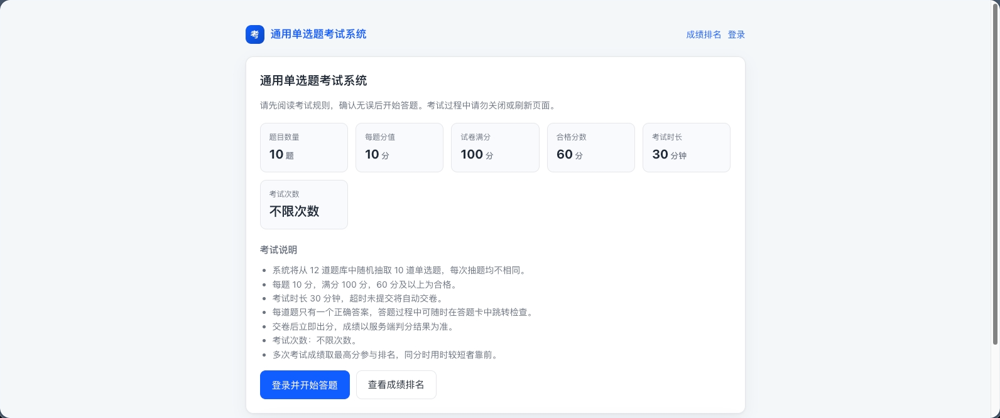
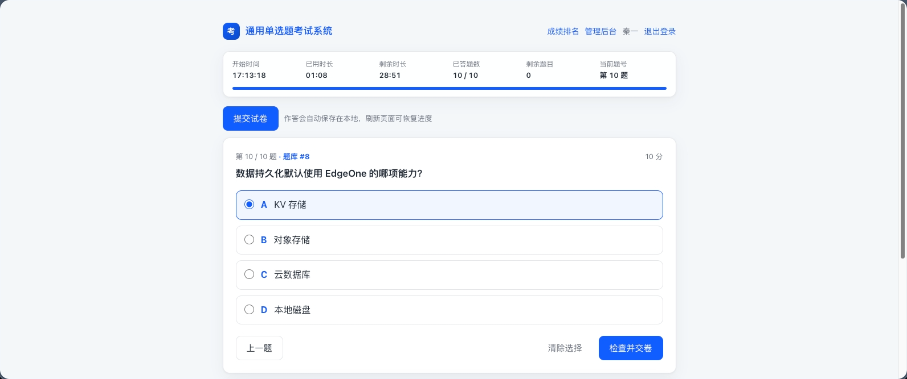
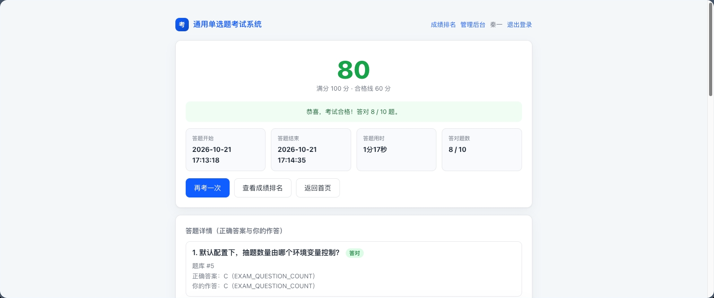
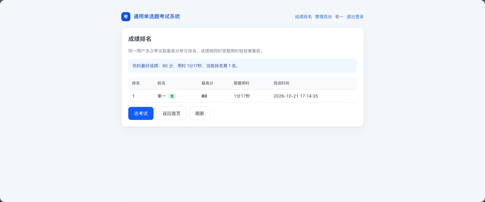
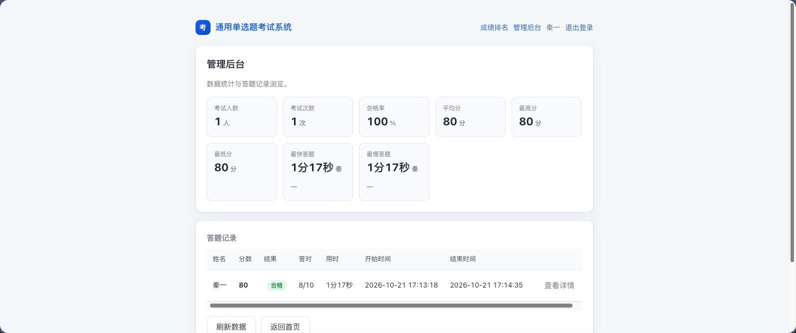
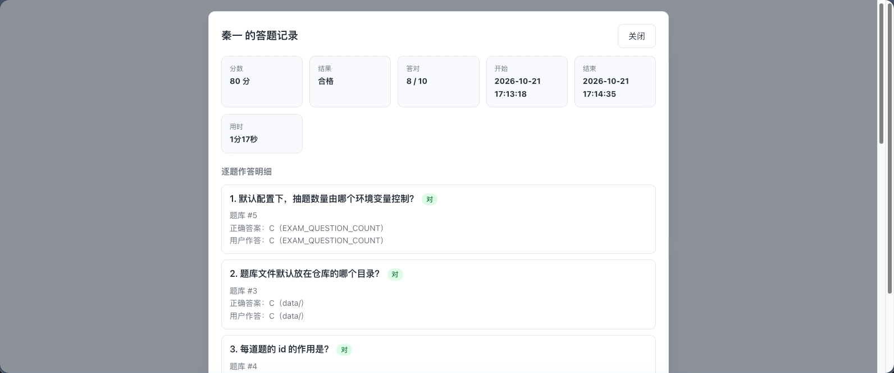

# 通用单选题考试系统

一套开箱即用的在线单选题考试系统，部署在腾讯云 EdgeOne（Pages / Makers）上：

- 前端：原生 HTML/CSS/JS，无构建步骤，静态资源直接托管
- 后端：EdgeOne **Edge Functions**（`edge-functions/`，Edge Runtime）
- 存储：EdgeOne **KV 存储**（成绩、排名、统计）
- 题库：一个 JSON 文件，改完即用
- 登录：可选接入腾讯统一身份认证 OneID（OIDC 授权码 + PKCE），也可以完全不登录直接答题
- 后台：密码登录或 OneID 白名单，两种方式可并存

## 一键部署

<a href="https://console.cloud.tencent.com/edgeone/makers/new?repository-url=https%3A%2F%2Fgithub.com%2FAirmole%2Fsimple-exam&output-directory=.%2Fpublic&root-directory=.%2F&env=SITE_URL%2CSITE_NAME%2CSITE_LOGO%2CBRAND_COLOR%2CEXAM_QUESTION_COUNT%2CEXAM_POINTS_PER_QUESTION%2CEXAM_PASS_SCORE%2CEXAM_DURATION_MINUTES%2CADMIN_PASSWORD_LOGIN%2CADMIN_PASSWORD%2CSESSION_SECRET" target="_blank">
  
</a>

点上面的按钮，把本仓库导入自己的 EdgeOne Pages 项目。

导入后按下面的「部署到 EdgeOne」补齐构建配置、KV 绑定与环境变量。

## 项目截图













## 功能一览

| 模块 | 说明 |
| --- | --- |
| 题库 | `data/questions.json` 里写题目，改完重新部署即生效；启动时校验格式，写错会在接口里直接报出第几题 |
| 抽题 | 从题库随机抽取 N 道，每人每场题目不同、顺序不同 |
| 答题 | 单选，支持答题卡跳转、上一题/下一题、清除选择；作答本地暂存，误刷新可恢复 |
| 考试控制 | 时长倒计时、到点自动交卷；每人限考次数；截止时间统一收起所有入口 |
| 判分 | 服务端判分，正确答案不下发前端；交卷后立即出分 |
| 成绩 | 分数、是否合格、用时、逐题作答；可按开关决定是否公开正确答案 |
| 排名 | 同一用户取最高分，同分用时短者靠前；可整体关闭 |
| 免登录答题 | 一个开关决定游客能不能直接考；答完立即出分，但不落库、不进统计、不参与排名 |
| 管理后台 | OneID 白名单或后台密码均可进入，可看考试人数/次数/合格率/平均分/最高最低分，以及每条答题记录详情 |
| 品牌 | 站点名、Logo 文字、主题色都能用环境变量改，不用改代码 |

## 目录结构

```
data/
  questions.json               # 题库（当前生效的题库）
  questions.example.json       # 示例题库，换题时可直接覆盖到 questions.json
public/                        # 静态前端（构建输出目录）
  index.html
  logout-done.html             # 登出回跳落地页
  css/style.css
  js/app.js                    # hash 路由
  js/site.js                   # 站点配置（品牌、主题色、截止时间）与缓存
  js/api.js  js/util.js  js/components.js
  js/pages/{home,exam,result,ranking,admin}.js
edge-functions/
  api/[[default]].js           # 统一入口，/api/* 全走这里
  api/_lib/
    router.js                  # 路由分发
    config.js                  # 环境变量读取、截止时间解析、KV 绑定
    questions.js               # 题库加载、校验与随机抽题
    question-bank.js           # 题库的 JS 副本（无法导入 JSON 时的兜底）
    scoring.js                 # 判分与单选作答归一化
    store.js                   # KV 数据模型、key 规范与统计
    oidc.js  crypto.js  http.js
test/                          # 本地测试与开发服务器（不参与生产构建）
  run.mjs                      # 接口集成测试
  bank.mjs                     # 题库解析、抽题与判分单元测试
  auth.mjs                     # 认证与加密单元测试
  dev-server.mjs               # 本地开发服务器（含 mock OIDC）
  mock-kv.js                   # 内存 KV
```

## 换题库：改一个 JSON 就行

`data/questions.json` 是一个数组，每题四个字段：

```json
[
  {
    "id": 1,
    "question": "TCP 三次握手的第二个报文携带哪个标志位？",
    "options": { "A": "SYN", "B": "SYN + ACK", "C": "ACK", "D": "FIN" },
    "answer": "B"
  }
]
```

规则：

- `question` 必填，纯文本
- `options` 至少 2 项，键建议用 `A`/`B`/`C`/`D`（最多支持到 `H`），按字母顺序展示
- `answer` 必须是 `options` 里的某个键（大小写不敏感，统一按大写处理）
- `id` 是判分与成绩解析的锚点，题目之间不能重复；不填会按顺序自动补

改完 `data/questions.json` 后有两种落地方式：

1. 重新部署一次（数据文件会随函数一起打包，最稳妥）；
2. 同时把内容同步到 `edge-functions/api/_lib/question-bank.js`（`export const QUESTION_BANK = [...]`），
   它是运行时导不了 JSON 时的兜底来源。

题库写错不用等交卷：`/api/exam/rules`、`/api/meta` 会直接返回「第 3 题至少需要 2 个选项」这类提示。
`test/bank.mjs` 也会在本地就先报出来。

## 部署到 EdgeOne

### 1. 创建 Makers 项目

导入自己的仓库，构建配置：

| 项 | 值 |
| --- | --- |
| 根目录 | `./` |
| 构建命令 | 留空（无构建步骤） |
| 输出目录 | `public` |

### 2. 开通 KV 并绑定

控制台 → **Pages → 存储 → KV 存储** → 开通账户 → 创建命名空间（免费版 1GB）。

项目设置 → **KV 存储** → 绑定命名空间，**变量名填 `EXAM_KV`**（与 `KV_BINDING` 一致）。

> 绑定名不是环境变量：EdgeOne 会把它注入成运行时**全局变量**，函数里直接 `EXAM_KV.get(...)` 访问，
> 不在 `context.env` 上。`getKV()` 优先读全局，其次兼容 `env[绑定名]`。

排查「未找到 KV 绑定」：

1. 绑定是不是加在**这个**项目上（同名项目容易点错），且变量名与 `KV_BINDING` 完全一致（大小写敏感）；
2. 绑定是在**当前生效的那次部署之后**才加的 —— 在「部署」里对最新提交重新构建一次；
3. 看接口返回：`503 { code: "KV_BINDING_MISSING", binding: "EXAM_KV", error: "..." }`，
   `error` 里带上运行时实际读到的同名值类型，能区分「没读到」和「读到了但不是 KV 对象」。

### 3. 配置环境变量

项目设置 → 环境变量，按 `.env.example` 填。最小可用的一组：

```
SITE_URL=https://exam.example.com
SITE_NAME=通用单选题考试系统
SITE_LOGO=考
BRAND_COLOR=#0f5fff
EXAM_QUESTION_COUNT=10
EXAM_POINTS_PER_QUESTION=10
EXAM_PASS_SCORE=60
EXAM_DURATION_MINUTES=30
ADMIN_USERS=admin@example.com
```

> 改完环境变量要**重新部署**一次，边缘函数不会自动读取新值。

### 4. 绑定域名

把 `exam.example.com`（换成自己的域名）解析到 Makers 项目并绑定证书。
`SITE_URL` 必须与最终访问域名完全一致（含协议、不带结尾斜杠），否则登录回调的域名校验会失败。

### 5. 接入统一身份认证（可选）

如果需要「先登录再考试」，在 OneID 侧登记两个地址，并配置对应环境变量：

| 用途 | 登记地址 | 环境变量 |
| --- | --- | --- |
| 登录回调 | `https://exam.example.com/api/auth/callback` | 由 `SITE_URL` 自动拼接 |
| 登出回跳 | `https://exam.example.com/logout-done` | `OIDC_LOGOUT_REDIRECT_URI` |

```
OIDC_ISSUER=https://oauth2.account.tencent.com/authz/oidc/v2/<应用ID>
OIDC_CLIENT_ID=<客户端ID>
OIDC_CLIENT_SECRET=<客户端密钥>
OIDC_LOGOUT_REDIRECT_URI=https://exam.example.com/logout-done
SESSION_SECRET=<openssl rand -hex 32>
```

本地调试时把回调地址换成 `http://127.0.0.1:8787/api/auth/callback`。

回调停在 `invalid_client`：

- `OIDC_CLIENT_ID` / `OIDC_CLIENT_SECRET` 是否与 OneID 应用配置完全一致（多余空格也算不一致）；
- 密钥含非 ASCII 字符时 `Basic` 头承载不了，把 `OIDC_CLIENT_AUTH_METHOD` 设为 `post`；
- 改完配置要重新部署。

登出被拒（`Invalid post_logout_redirect_uri`）时本站会自动退回首页：会话已经清掉，
再点登录会重新走授权，不会停在报错 JSON 上。

## 环境变量

### 站点

| 变量 | 默认值 | 说明 |
| --- | --- | --- |
| `SITE_URL` | 请求 origin | 站点地址，用于拼接登录回调与登出跳转；填的不是 `http(s)://` 绝对地址时按未配置处理 |
| `SITE_NAME` | `通用单选题考试系统` | 站点名称，显示在浏览器标题、顶部导航与首页标题 |
| `SITE_LOGO` | `Q` | Logo 文字，1~2 个字符 |
| `BRAND_COLOR` | `#0f5fff` | 主题色（十六进制），按钮、链接、Logo 一并跟随；非法值回退默认 |

### 考试规则

| 变量 | 默认值 | 说明 |
| --- | --- | --- |
| `EXAM_QUESTION_COUNT` | `10` | 每场抽题数量；题库不足时按题库实际数量出卷，满分随之变化 |
| `EXAM_POINTS_PER_QUESTION` | `10` | 每题分值，满分 = 抽题数量 × 每题分值 |
| `EXAM_PASS_SCORE` | `60` | 及格分 |
| `EXAM_DURATION_MINUTES` | `30` | 考试时长（分钟），到点自动交卷 |
| `EXAM_MAX_ATTEMPTS` | `0` | 每人最多考试次数，`0` 或留空为不限 |
| `EXAM_DEADLINE` | 空 | 截止时间，**按北京时间（UTC+8）**解析，如 `2026-12-31 23:59`；留空不限。截止后前端隐藏所有开考入口，服务端拒绝开考 |

### 展示与留存开关

| 变量 | 默认值 | 说明 |
| --- | --- | --- |
| `EXAM_SHOW_RANKING` | `true` | 是否公开成绩排名；`false` 时隐藏入口且 `/api/ranking` 返回 403 |
| `EXAM_SHOW_ANSWER` | `true` | 交卷后是否展示正确答案与逐题对错；`false` 时只给分数和你的作答（管理端详情同样裁剪） |
| `EXAM_KEEP_RECORDS` | `true` | 是否把答题记录写入 KV；`false` 时不落库、不参与排名，成绩只在交卷响应里返回 |
| `EXAM_ALLOW_GUEST` | `false` | 是否允许不登录答题；见下方「免登录答题」 |

开关取值：`true`/`1`/`on`/`yes` 为开，`false`/`0`/`off`/`no` 为关，留空取默认。

> 上述规则与开关都通过 `/api/site`、`/api/meta` 下发给前端，**不需要改前端代码或重新构建静态资源**。

### 认证与管理

| 变量 | 默认值 | 说明 |
| --- | --- | --- |
| `OIDC_ISSUER` | — | OneID issuer |
| `OIDC_CLIENT_ID` | — | 客户端 ID |
| `OIDC_CLIENT_SECRET` | — | 客户端密钥 |
| `OIDC_CLIENT_AUTH_METHOD` | 空（先 `basic` 再 `post`） | 客户端认证方式 |
| `OIDC_SCOPES` | `openid profile` | 申请 scope |
| `OIDC_LOGOUT_REDIRECT_URI` | 空（回站点首页） | 登出后回跳地址，必须是 OneID 里登记过的那个 |
| `SESSION_SECRET` | 回退用 client secret | 会话签名/加密密钥，建议单独配置 |
| `ADMIN_USERS` | 空 | 管理后台白名单，逗号分隔，匹配 `preferred_username`/`email`/`mobile`/`sub`（忽略大小写） |
| `ADMIN_PASSWORD` | 空 | 管理后台密码，至少 6 位；配置后即可用密码进后台，不依赖 OneID |
| `ADMIN_PASSWORD_LOGIN` | `true` | 密码登录总开关；设为 `false` 时只认 OneID 白名单 |
| `KV_BINDING` | `EXAM_KV` | KV 绑定的运行时变量名 |

## 免登录答题

默认要登录才能考。把 `EXAM_ALLOW_GUEST` 打开（配合不接 OneID）：

```
EXAM_ALLOW_GUEST=true
```

未登录的访客在首页直接看到「直接开始答题」，答完当场出分，规则是：

- 成绩只在交卷响应里返回，浏览器存在 `sessionStorage`，**刷新即失**，服务端不写任何记录；
- 不写 `exam_record_` / `exam_user_` / `exam_stats`，因此**不进统计、不进排名**；
- 游客身份由服务端签发的 `guestId` 代表（存 `localStorage`），试卷落在 `exam_gpaper_<guestId>` 并带 TTL；
- 没有试卷凭据就不能交卷（防止绕过抽题直接刷分），且同一 `guestId` 交完即废，不能重复提交；
- 游客没有稳定身份，`EXAM_MAX_ATTEMPTS` 对它不生效，只受 `EXAM_DEADLINE` 约束。

使用上的取舍：打开后任何人都能拿到分数与逐题解析（`EXAM_SHOW_ANSWER` 仍可关掉答案），
适合练习、自测、活动预热；如果是计分考试，保持关闭，或把 `EXAM_SHOW_RANKING`、`EXAM_SHOW_ANSWER` 一起收紧。

## 管理后台的两种进入方式

**方式一：后台密码**（不需要 OneID）

```
ADMIN_PASSWORD=<openssl rand -base64 18>
```

- 访问 `#/admin` 会直接给密码表单，POST 到 `/api/auth/admin-login`；
- 通过后下发独立的 `exam_admin` Cookie（HttpOnly、SameSite=Lax、AES-GCM 加密 + HMAC 签名，4 小时过期），
  并**不影响** `exam_session` 的登录态：后台登出不会把人踢出考试系统，反之亦然；
- 密码会话只给后台用，不算「已登录用户」，不能开考，`/api/meta` 里会标 `adminVia: "password"`；
- 同一来源 IP 连错 5 次锁 10 分钟（`429 ADMIN_LOGIN_LOCKED`），锁按 IP 隔离；
- 密码少于 6 位按未配置处理；`ADMIN_PASSWORD_LOGIN=false` 可随时关掉密码入口。

**方式二：OneID 白名单**（`ADMIN_USERS`，见上表）。两种方式可以同时开，任意一条通过都算管理员。

## 接口

| 方法 | 路径 | 说明 |
| --- | --- | --- |
| GET | `/api/site` | 站点品牌配置、排名开关、截止状态（不依赖 KV） |
| GET | `/api/meta` | 站点信息、题库总量、考试规则、登录态、剩余次数 |
| GET | `/api/exam/rules` | 考试规则 |
| POST | `/api/exam/start` | 抽题开考，返回题目（不含答案）与起止时间；游客返回 `guestId` |
| GET | `/api/exam/questions` | 取整卷或单题（`?index=N`）；游客需带 `?guestId=` |
| POST | `/api/exam/submit` | 交卷判分；`answers` 为 `{ 题号: 选项字母 }`，游客需带 `guestId` |
| GET | `/api/ranking` | 成绩排名（`EXAM_SHOW_RANKING=false` 时 403） |
| GET | `/api/auth/login?returnTo=` | 跳转 OneID 授权 |
| GET | `/api/auth/callback` | 授权回调，换取用户信息并建会话 |
| GET | `/api/auth/logout` | 清除会话；OneID 受理回跳时跳 `fclogout`，否则直接回首页 |
| GET | `/api/auth/me` | 当前登录态、是否管理员、考试规则、剩余次数 |
| POST | `/api/auth/admin-login` | 用 `ADMIN_PASSWORD` 换后台会话，body `{ "password": "..." }` |
| GET | `/api/auth/admin-logout` | 清除后台密码会话 |
| GET | `/api/admin/stats` | 统计指标（仅管理员） |
| GET | `/api/admin/records` | 答题记录列表（仅管理员） |
| GET | `/api/admin/record?id=` | 单条记录详情（仅管理员） |

错误码约定：`401` 未登录/密码错误、`403` 无权限/已截止/次数用尽/排名关闭/密码登录未开启、
`409` 无进行中的考试或已超时、`429` 后台密码试错被锁、`503 KV_BINDING_MISSING` 缺 KV 绑定。

## 数据模型（KV）

| Key | 内容 |
| --- | --- |
| `exam_record_<id>` | 单次答题记录，含逐题明细（题目、正确答案、用户答案） |
| `exam_user_<sub>` | 用户索引：全部记录 ID、最高分、最快用时、考试次数 |
| `exam_paper_<sub>` | 进行中的试卷（含 TTL，用于服务端判分） |
| `exam_gpaper_<gid>` | 游客进行中的试卷（含 TTL，交卷即删，不产生成绩记录） |
| `exam_stats` | 汇总统计：人数、次数、合格数、分数和、最快/最慢用时 |

EdgeOne KV 的 key 只允许**数字、字母、下划线**（≤ 512B），所以分隔符用 `_`，
`sub` 里的 `:`、`.`、`-` 等字符会先编码成 `_`（见 `store.js` 的 `keySegment`）。

排名不额外落库，由 `exam_record_` 前缀扫描后在内存聚合，避免维护多份索引导致不一致。

> EdgeOne KV 为最终一致性（跨节点最长 60s 可见），排名与统计的秒级延迟属预期行为。

> `kv.list()` 的 `cursor` 是**严格字符串**：首次查询不能带这个字段，带 `undefined` 会直接抛
> `cursor type invalid. expect: 'string' get: 'undefined'`。分页统一走 `store.js` 的 `listAllKeys()`，
> 它只在拿到非空 cursor 时才续翻。

## 本地开发与测试

```bash
# 题库解析 / 抽题 / 判分单元测试
node test/bank.mjs
# 接口集成测试（无需网络与 KV）
node test/run.mjs
# 认证与加密单元测试
node test/auth.mjs

# 本地开发服务器（自带 mock OIDC，无需真实 OneID）
node test/dev-server.mjs
# 打开 http://127.0.0.1:8787
```

本地也能试配置，例如：

```bash
SITE_NAME="内部认证考试" BRAND_COLOR="#e11d48" EXAM_MAX_ATTEMPTS=2 \
EXAM_QUESTION_COUNT=5 EXAM_POINTS_PER_QUESTION=20 node test/dev-server.mjs
```

不登录答题与密码后台也能本地直接试，不需要配 OneID：

```bash
# 游客答题 + 后台密码登录
EXAM_ALLOW_GUEST=true ADMIN_PASSWORD=dev-admin-pwd node test/dev-server.mjs
```

打开 `#/` 直接答题（刷新成绩页会消失，这是设计如此）；`#/admin` 输 `dev-admin-pwd` 进后台，
页面底部有「退出后台」清掉密码会话。

本地登录：访问 `/api/auth/login`，mock 提供方默认签发「李四」；
把跳转到的 `/mock-oidc/authorize` 地址末尾加上 `&user=code_admin` 即以管理员身份登录。

## 安全说明

- 正确答案仅存于服务端；`/api/exam/start` 下发的题目不含 `answer`，判分在提交时以题库为准；
  `EXAM_SHOW_ANSWER=false` 时连交卷响应里的答案与对错也不返回。
- 试卷落 KV 并带 TTL；即便 KV 跨节点暂未命中，交卷时也用服务端题库按题号判分，不接受前端传入的正确答案。
- 单选题只接受单个选项字母（`A`~`H`）且必须在选项内，多选、乱填一律按未作答处理。
- 超时交卷会被拒绝（`409 EXAM_TIMEOUT`）并清理进行中的试卷，只留有 90 秒传输余量。
- 截止时间与次数限制在服务端强制校验，前端隐藏入口只是体验优化。
- 会话 Cookie 为 HttpOnly + SameSite=Lax，载荷经 AES-GCM 加密并用 HMAC-SHA256 签名。
- OIDC 使用授权码 + PKCE（S256）与 state 校验，防重放与 CSRF。
- 管理后台在服务端做白名单与密码校验，前端仅控制入口显示；密码以定长比较（先 SHA-256 再逐字节比），
  同一 IP 连续试错会锁定，响应里不回显任何配置。
- 游客答题不需要身份，因此**服务端不落任何记录**：没有 `recordId`、不进 `exam_stats`、不进排名；
  试卷凭据（`guestId`）由服务端签发，交卷后立即作废。
